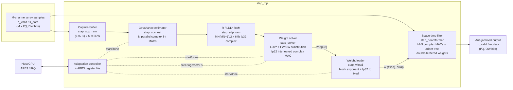
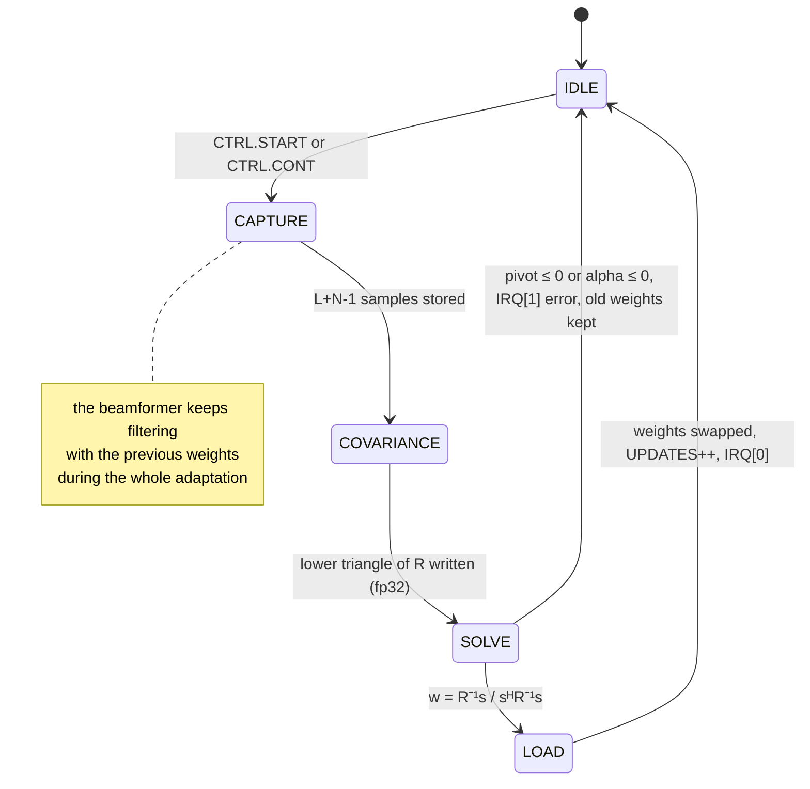
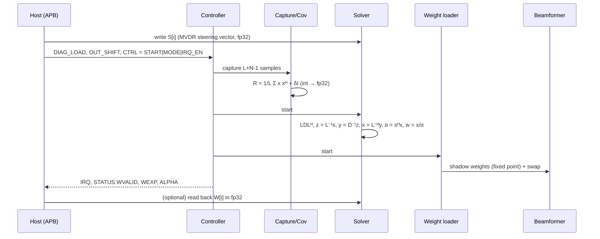
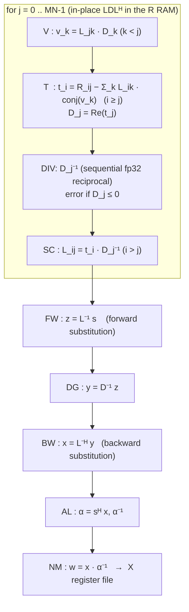
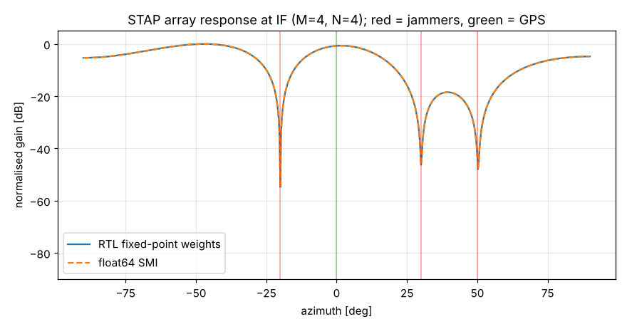
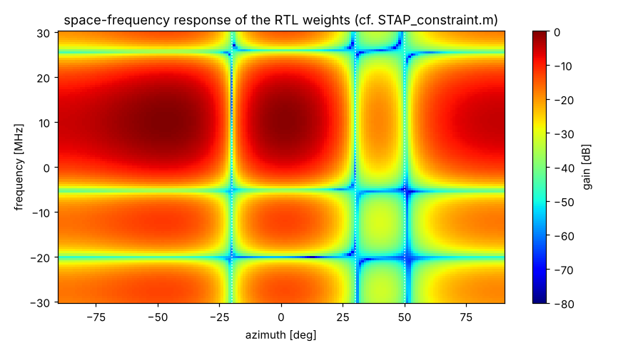
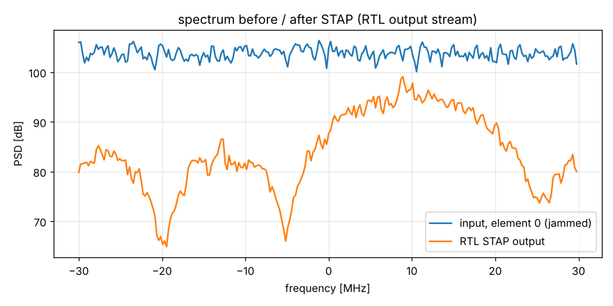

# STAP RTL IP: Space-Time Adaptive Processing anti-jamming core

Synthesizable Verilog-2005 implementation of the MATLAB STAP algorithm in
[`matlab_ref/`](matlab_ref) (`STAP_constraint.m`, `STAP_unconstraint.m`). The
core suppresses wideband jammers on a GNSS (GPS L1) antenna array. It estimates
the space-time covariance of the array samples, solves for the MVDR or
power-inversion weights in IEEE-754 single precision, and filters the live
sample stream with those weights.

| | |
|---|---|
| Algorithm | Sample-matrix-inversion STAP, `w = R⁻¹s / (sᴴR⁻¹s)` |
| Modes | **MVDR** (space-time steering vector, `STAP_constraint.m`) and **Power Inversion** (`s = e₁`, equivalent to `STAP_unconstraint.m`) |
| Default size | M = 7 elements × N = 16 taps → 112-dimensional space-time snapshot |
| Arithmetic | Exact integer covariance, fp32 LDLᴴ solver, fixed-point filter |
| Interfaces | Streaming sample in/out (valid/data), APB3 control and status, IRQ |
| Language | Plain Verilog-2005, no vendor primitives (simulated with Icarus, synthesized with Yosys) |
| Verification | Bit-exact against a Python golden model: covariance, weights, filter output |

---

## 1. Algorithm: MATLAB to RTL mapping

```
x(l)  = [y_0(l) .. y_0(l+N-1), y_1(l) .. , y_{M-1}(l+N-1)]ᵀ   space-time snapshot (MN x 1)
R     = 1/L · Σ_l x(l) x(l)ᴴ  + δ·I                          covariance (+ diagonal loading)
w     = R⁻¹ s / (sᴴ R⁻¹ s)                                    MVDR / power-inversion weights
y(n)  = wᴴ x(n)                                               adaptive filter output
```

| MATLAB (`STAP_constraint.m`) | RTL block | Notes |
|---|---|---|
| `circshift` loop that builds `Xm` | `stap_cov_est` sliding windows | element `i = m·N + t` holds `y_m(l+t)`, the same ordering as MATLAB |
| `Rx = Xm*Xm'./L` | `stap_cov_est` | exact 47-bit integer accumulation; the `1/L` is applied in the fp32 exponent (L = 2^LOG2L) |
| `S = kron(S_s, S_t)` | host writes `S` over APB | fp32, any look direction or frequency |
| `w_opt = (S'*inv(Rx)*S)^-1*inv(Rx)*S` | `stap_solver` | LDLᴴ factorization plus forward and back substitution. No explicit inverse. |
| `S = e1` (commented "power inversion" block) | `CTRL.MODE = 0` | `s = e₁` is generated internally |
| `w_opt = [1; -inv(R_mm)*R_m1]` (`STAP_unconstraint.m`) | `CTRL.MODE = 0` | the same as `R⁻¹e₁` normalized to `w₀ = 1` (block matrix inversion), so it is power inversion |
| `w_opt'*Xm` (`OutputPowerCalculate.m`) | `stap_beamformer` | `y = Σ conj(wᵢ)·xᵢ`, streaming |

---

## 2. Architecture

### 2.1 Top-level block diagram



Two paths run concurrently:

* **Data path** (every sample): `s_data` → tapped delay lines → `wᴴx` → `m_data`.
  It runs continuously and never stalls.
* **Adaptation path** (block-wise): it captures a block, estimates `R`, solves
  for `w`, and loads the new weights into the filter's shadow bank. The weights
  swap atomically, so the output never sees a half-updated weight set.

### 2.2 Adaptation flow





### 2.3 Covariance estimator (`stap_cov_est`)

```
  capture RAM ──► word a (all M channels) ──┬─► window_i  [channel mi]  N-deep shift reg
                                             └─► window_j  [channel mj]  N-deep shift reg
                                                     │
            x_i = window_i[ti]  ─────────────────────┤
                                                     ▼
                   ┌───── N parallel complex MACs: acc[tj] += x_i · conj(window_j[tj]) ─────┐
                   └──► int2fp (×2^-LOG2L, + δ on the diagonal) ──► R(mi·N+ti, mj·N+tj), i ≥ j
```

* One pass per `(mi ≥ mj, ti)` triple: `M(M+1)/2 · N` passes. Each pass streams
  the captured block once and produces `N` entries of `R`.
* The accumulation is exact (2·DW + LOG2L + 3 bits). The only rounding is the
  final round-to-nearest-even conversion to fp32.

### 2.4 Weight solver (`stap_solver`)

All arithmetic goes through one **interleaved complex fp32 dot-product engine**
(`stap_cdot_engine`: 4 fp multipliers and 4 fp adders, 6-cycle pipeline). It
computes `acc[slot] ← (first ? 0 : acc[slot]) − a·conj(b)` once per clock.
Dot products that don't depend on each other are interleaved round-robin over
G = 4 slots, which hides the accumulator latency. Only one RAM read port is
needed, because the "initial value" of each dot product is fed in as an extra
term `R_ij·(−1)`.



Phases are separated by pipeline drains, so the RAM and register files never
have a read-after-write hazard. The engine runs at nearly full utilization in
the dominant `T` phase (≈ MN³/6 complex MACs).

### 2.5 Space-time filter (`stap_beamformer`)

```
 s_data ─► TDL ch0: x[0..N-1] ─┐
          TDL ch1: x[N..2N-1] ─┤   conj(wᵢ)·xᵢ      pipelined adder tree      round, shift
           ...                 ├─► M·N complex ──► log2(M·N) levels ──► OUT_SHIFT, sat ─► m_data
          TDL chM-1           ─┘   multipliers
                                      ▲
                 active weights ◄─ swap ─ shadow weights ◄─ stap_wload
```

* One output per input sample, latency `4 + ⌈log2(M·N)⌉` clocks.
* Weights are `WW`-bit two's complement with `WFRAC` fraction bits. `stap_wload`
  applies a **block exponent** `k = 126 − Emax`, so the largest weight
  component lands in [0.5, 1). This keeps the full weight precision whatever
  the absolute scale of `R`. The applied `k` is reported in `WEXP`, and the
  output gain is `2^k`.
* After reset the weights are `w = e₁` (unity pass-through of element 0, tap 0),
  so the output carries the raw reference channel until the first adaptation
  completes.

---

## 3. Directory structure

```
STAP_RTL_IP/
├── rtl/
│   ├── stap_top.v           top level: APB registers, adaptation controller, block wiring
│   ├── stap_cov_est.v       space-time covariance estimator (integer → fp32)
│   ├── stap_solver.v        LDLᴴ MVDR / power-inversion solver (fp32)
│   ├── stap_cdot_engine.v   interleaved complex fp32 multiply-accumulate engine
│   ├── stap_beamformer.v    M×N-tap space-time filter, double-buffered weights
│   ├── stap_wload.v         block-exponent fp32 → fixed-point weight loader
│   ├── stap_fp_add.v        IEEE-754 fp32 adder (2-stage, RNE)
│   ├── stap_fp_mul.v        IEEE-754 fp32 multiplier (2-stage, RNE)
│   ├── stap_fp_recip.v      IEEE-754 fp32 reciprocal (sequential, RNE)
│   ├── stap_int2fp.v        integer → fp32 with power-of-two scale
│   ├── stap_fp2fix.v        fp32 → fixed point with run-time exponent
│   └── stap_sdp_ram.v       generic simple dual-port RAM (BRAM inference)
├── tb/
│   ├── tb_stap_top.v        system testbench (APB programming, streaming, dumps)
│   └── tb_fp_units.v        floating-point unit testbench
├── model/
│   ├── stap_model.py        scenario generator + bit-accurate golden model + checker
│   └── check_fp_units.py    fp unit vector generator / checker (vs numpy float32)
├── sim/run_sim.sh           regression script (Icarus Verilog)
├── docs/                    array response, space-frequency response and PSD plots
└── matlab_ref/              original MATLAB algorithm (reference)
```

---

## 4. Parameters (`stap_top`)

| Parameter | Default | Description |
|---|---|---|
| `M` | 7 | number of antenna elements (`settings.RecNum`) |
| `N` | 16 | taps per element (`settings.orders`) |
| `DW` | 16 | input I/Q sample width |
| `LOG2L` | 12 | snapshots per covariance estimate, `L = 2^LOG2L` (MATLAB: `L = 5000`) |
| `WW` | 18 | beamformer weight width |
| `WFRAC` | 16 | weight fraction bits |
| `OW` | 16 | output I/Q width |
| `G` | 4 | solver interleave factor (≥ 3) |

---

## 5. Interfaces

| Port | Dir | Width | Description |
|---|---|---|---|
| `clk`, `rst_n` | in | 1 | clock, active-low asynchronous reset |
| `s_valid` | in | 1 | input sample strobe (any duty cycle, ≤ 1 per clock) |
| `s_data` | in | `M·2·DW` | channel *m* at `s_data[m·2DW +: 2DW] = {Q, I}` |
| `m_valid` | out | 1 | output sample strobe (one per input sample) |
| `m_data` | out | `2·OW` | `{Q, I}` of `wᴴx` |
| `psel penable pwrite paddr[15:0] pwdata prdata pready pslverr` | | | APB3 slave |
| `irq` | out | 1 | level interrupt, `IRQ_EN & (IRQ_STATUS ≠ 0)` |

There is no back-pressure on the sample interfaces. This is a streaming DSP
core: the clock must be at least the sample rate (for example fs = 60 MHz in
the MATLAB settings, clk = 200 MHz).

## 6. Register map (APB, byte addresses)

| Offset | Name | Access | Bits |
|---|---|---|---|
| `0x000` | `CTRL` | RW | `[0]` START (write 1 to run one adaptation) · `[1]` CONT (adapt continuously) · `[2]` MODE (1 = MVDR, 0 = power inversion) · `[8]` IRQ_EN |
| `0x004` | `STATUS` | RO | `[0]` BUSY · `[1]` WVALID (adapted weights active) · `[2]` ERR · `[5:4]` ERR_CODE (1 = pivot ≤ 0, 2 = sᴴR⁻¹s ≤ 0) · `[10:8]` FSM state · `[31:16]` ERR_COL |
| `0x008` | `DIAG_LOAD` | RW | δ, added to `R(i,i)` in covariance units (LSB²) |
| `0x00C` | `OUT_SHIFT` | RW | `[5:0]` output right shift (default `WFRAC`) |
| `0x010` | `UPDATES` | RO | number of completed weight updates |
| `0x014` | `WEXP` | RO | signed block exponent `k` of the active weights (output gain 2^k) |
| `0x018` | `ALPHA` | RO | `sᴴR⁻¹s` (fp32) |
| `0x01C` | `INFO` | RO | `[7:0]` M · `[15:8]` N · `[23:16]` LOG2L · `[31:24]` version |
| `0x020` | `IRQ_STATUS` | W1C | `[0]` update done · `[1]` solver error |
| `0x024` | `CYCLES` | RO | clock cycles of the last adaptation |
| `0x1000 + 8i` | `S_RE[i]` | WO | steering vector element *i* real part (fp32) |
| `0x1004 + 8i` | `S_IM[i]` | WO | steering vector element *i* imaginary part (fp32) |
| `0x2000 + 8i` | `W_RE[i]` | RO | solved weight *i* real part (fp32), valid while BUSY = 0 |
| `0x2004 + 8i` | `W_IM[i]` | RO | solved weight *i* imaginary part (fp32) |

Element index `i = m·N + t` (element *m*, tap *t*, where *t* = N−1 is the
newest sample).

### Programming sequence

```c
// MVDR steering vector toward (theta, f_IF):  s = kron(S_s, S_t)
for (m = 0; m < M; m++)
  for (t = 0; t < N; t++) {
    float ph = -2*PI*d*sin(theta)/lambda*m + 2*PI*f_IF*Ts*t;
    apb_wr(0x1000 + 8*(m*N+t), f2u(cosf(ph)));
    apb_wr(0x1004 + 8*(m*N+t), f2u(sinf(ph)));
  }
apb_wr(0x008, diag_load);           // e.g. 0.1 x noise power per element (LSB^2)
apb_wr(0x00C, 16);                  // output shift
apb_wr(0x000, START | MODE_MVDR | IRQ_EN);   // or CONT for continuous tracking
// ... IRQ ... check STATUS.ERR, read WEXP / ALPHA / CYCLES, write 1s to IRQ_STATUS
```

---

## 7. Number formats and accuracy

| Quantity | Format |
|---|---|
| input samples | signed `DW`-bit I/Q |
| covariance accumulation | exact signed integer, `2·DW + LOG2L + 3` bits |
| `R`, `L`, `D`, `w`, `s` | IEEE-754 binary32. Round to nearest even, denormals flushed to zero. |
| beamformer weights | signed `WW` bits, `WFRAC` fraction bits, shared block exponent |
| output | `Σ conj(w)x` with full precision, then `OUT_SHIFT` with round-half-up and saturation to `OW` bits |

Every fp operator has been checked bit for bit against numpy float32 (20,000
random vectors each, including cancellation and exact-zero cases).

---

## 8. Throughput and latency

| Stage | Clock cycles | M=7, N=16, L=4096 | @ 200 MHz |
|---|---|---|---|
| Capture | `L + N − 1` input samples | 4,111 samples | 68.5 µs at fs = 60 MHz |
| Covariance | `M(M+1)/2 · N · (L + 2N + 7)` | pending | pending |
| Solver | ≈ `(MN)³/6 + 4·G·(MN)²/2 + 70·MN` | pending | pending |
| Weight load | `2·MN + 10` | 234 | 1.2 µs |
| **Adaptation total** (measured `CYCLES`) | | pending | pending  |
| Filter latency | `4 + ⌈log2(MN)⌉` | 11 | 55 ns |

The filter processes one sample per clock regardless of adaptation.
Covariance estimation dominates the adaptation time. It can be cut in half by
instantiating `stap_cov_est` twice, or by decimating snapshots (smaller `LOG2L`).

### Resource estimate (default configuration)

| Block | Multipliers (DSP) | Memory |
|---|---|---|
| Beamformer (`4·M·N` 16×18) | 448 | 2 × 112 × 36 b weight registers |
| Covariance (`4·N` 16×16) | 64 | capture RAM 4111 × 224 b ≈ 0.92 Mb |
| Solver (4 fp32 mul, 24×24) | ~8–16 | R/LDLᴴ RAM 6328 × 64 b ≈ 0.40 Mb, 7 × 112-entry register files |

For a smaller DSP budget, fold the beamformer (time-multiplex the `M·N`
products when `clk ≫ fs`) or use 3-multiplier complex products.

---

## 9. Verification

`sim/run_sim.sh` runs the full regression with Icarus Verilog plus Python
(numpy, matplotlib for the plots):

```bash
./sim/run_sim.sh fp       # fp32 add / mul / reciprocal / int2fp vs numpy float32
./sim/run_sim.sh small    # M=4  N=4  L=1024  MVDR
./sim/run_sim.sh pi       # M=4  N=8  L=1024  power inversion
./sim/run_sim.sh full     # M=7  N=16 L=4096  MVDR (default IP configuration)
PLOTS=docs ./sim/run_sim.sh all
```

**Scenario** (`model/stap_model.py gen`, following `iniSettings.m`): GPS L1
C/A PRN 1 BPSK at IF = 10 MHz, fs = 60 MHz, SNR = −31.37 dB, arriving from 0°.
There are 3 wideband random-phase-modulated jammers (`GenWBInterSig2.m`) at
8, 10 and 12 MHz from −20°, 30° and 50°, each with JSR = 50 dB. The array is a
7-element ULA with d = λ/2, using a true-time-delay wideband array model
(`GenArraySignal.m`). Samples are quantized to 16-bit I/Q.

**Checks** (`model/stap_model.py check`):

1. **Covariance**: every entry of the RTL R RAM matches the exact integer model
   **bit for bit**.
2. **fp32 weights**: they match a Python model that runs the RTL's exact fp32
   operation order **bit for bit**. They are also within ~1e-5 relative error
   of a float64 `R⁻¹s / sᴴR⁻¹s`.
3. **Fixed-point weights and block exponent**: bit-exact.
4. **Output stream**: every `m_data` sample before the update (pass-through
   weights) and after it (adapted weights) is **bit-exact**.
5. **Anti-jamming performance**: output SINR with the RTL fixed-point weights,
   measured on samples after the training block, compared with float64 SMI.

### Results

| Config | Covariance | fp32 w | fixed w | output stream | SINR in → out | jammer suppression | loss vs float64 |
|---|---|---|---|---|---|---|---|
| small (M=4, N=4, MVDR) | bit-exact | bit-exact | bit-exact | bit-exact | −54.8 → −34.0 dB | 21.1 dB | 0.00 dB |
| full (M=7, N=16, MVDR) | pending | pending | pending | pending | pending | pending | pending |

The power-inversion and full-size results will be added after the full regression run.

Plots (small configuration, M=4 × N=4; plots for the full size will be added after its run):

| Array response at IF | Space-frequency response | Spectrum before and after |
|---|---|---|
|  |  |  |

The nulls fall exactly on the three jammer directions. The 2-D response shows
broadband nulls across the full 20 MHz+ jammer bandwidth, which is the point of
the extra taps (compare with the MATLAB `surfc` plot in `STAP_constraint.m`).
The output spectrum shows the jammer floor removed.

---

## 10. Notes and differences from the MATLAB code

* **Snapshot count**: MATLAB uses `L = 5000`. The IP uses `L = 2^LOG2L`
  (default 4096), which turns the `1/L` division into an exponent offset.
* **Diagonal loading** (`DIAG_LOAD`) is an addition that MATLAB doesn't have
  (set it to 0 for the exact MATLAB result). A small load (about −10 dB of the
  noise power) makes the weights robust to finite-sample effects.
* **Steering vector**: `STAP_constraint.m` writes `S_s = exp(-1i*pi*d*sind(θ)·m)`
  with `d` in meters, which is only correct for θ = 0. The host should compute
  `exp(-j2π·d·sinθ/λ·m)`. With the default θ = 0 both give all ones.
* **Edge handling**: MATLAB builds snapshots with `circshift` (wrap-around at
  the block end). The IP captures `L + N − 1` samples, so every snapshot holds
  real data.
* **Errors**: a non-positive pivot (R not positive definite, for example an
  all-zero input) or `sᴴR⁻¹s ≤ 0` aborts the update. The previous weights stay
  active, and `STATUS.ERR` and `IRQ_STATUS[1]` are set.
* **ASIC use**: replace `stap_sdp_ram` with compiled SRAM macros. All other
  logic is generic RTL.
