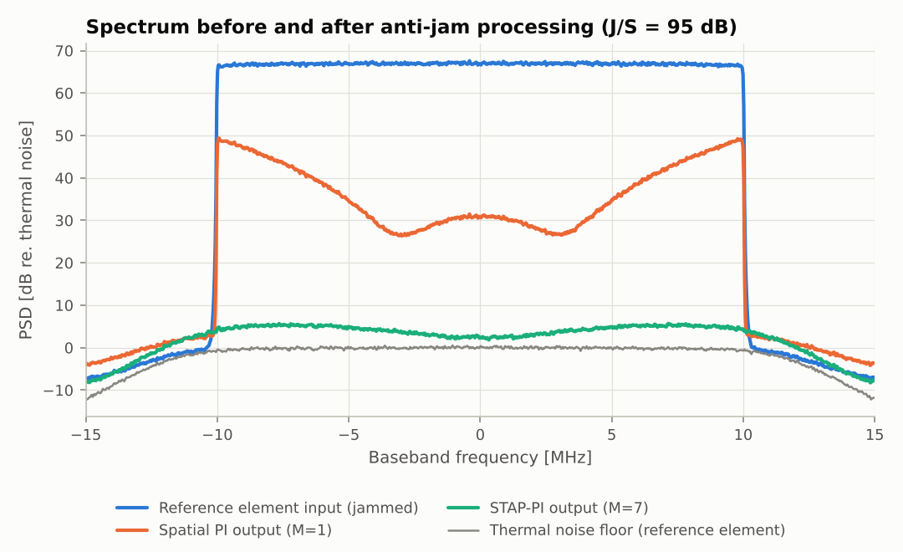
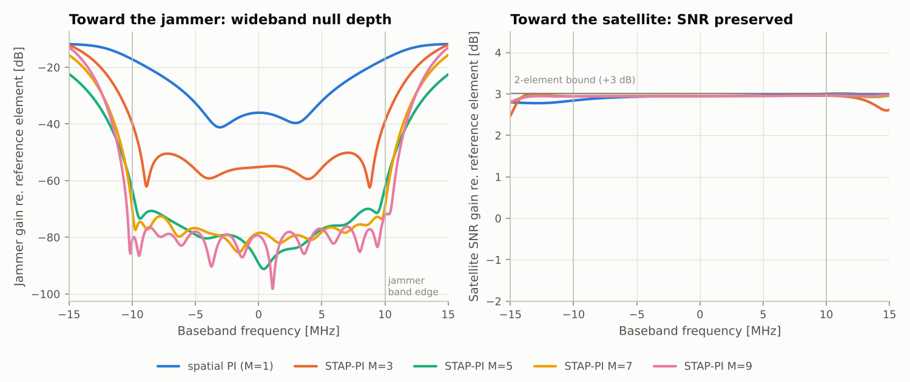
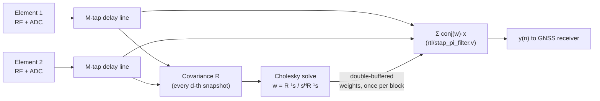
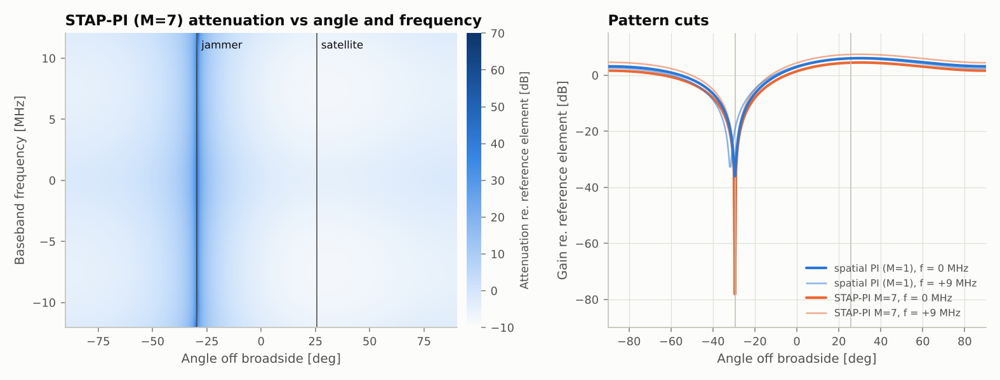
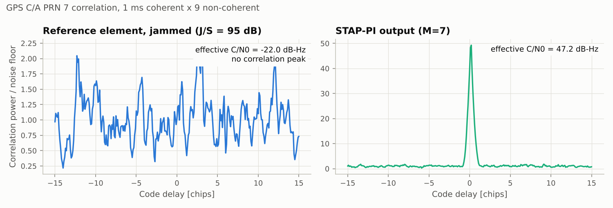
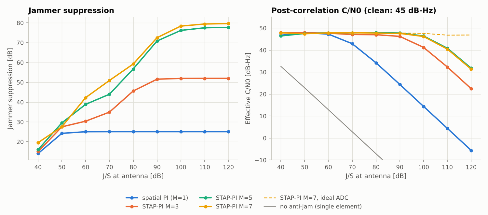
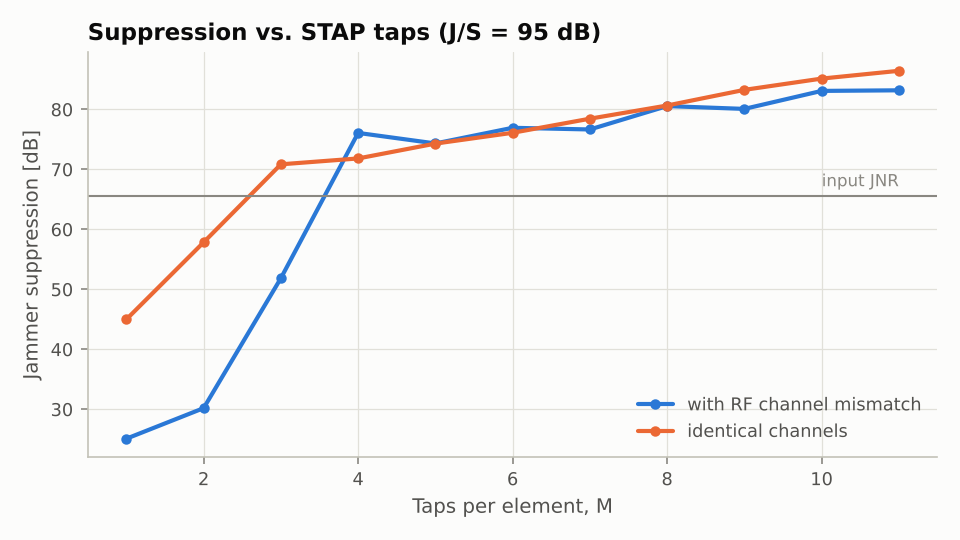
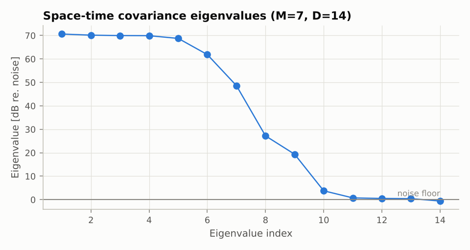

# STAP-PI anti-jam for a 2-element CRPA, against a wideband barrage jammer

This folder holds a Space-Time Adaptive Processing / Power-Inversion (STAP-PI) anti-jam
algorithm for a 2-element GNSS CRPA (Controlled Reception Pattern Antenna). It targets a
high-power, wideband (barrage) noise jammer. It contains:

| Part | Where | Status |
|---|---|---|
| Floating-point reference algorithm, scenario generator, metrics | [`python/stap_pi/`](python/stap_pi) | tested (`pytest`) |
| Demo that produces every figure and number below | [`python/run_demo.py`](python/run_demo.py) | |
| MATLAB / GNU Octave port (no toolboxes needed) | [`matlab/`](matlab) | matches Python to 1e-9 (automated cross-check) |
| Synthesizable Verilog space-time filter (weights applied in real time) | [`rtl/stap_pi_filter.v`](rtl/stap_pi_filter.v) | bit-exact against the fixed-point model (Icarus co-simulation) |
| Bit-true fixed-point model of the RTL | [`python/stap_pi/fixed_point.py`](python/stap_pi/fixed_point.py) | |

## Headline result

Scenario: GPS L1 C/A satellite at C/N0 = 45 dB-Hz. A 20 MHz barrage jammer at
**J/S = 95 dB** (JNR = 65.5 dB after the front-end), arriving 55° away from the satellite.
The two elements are λ/2 apart. The front-end is 24 MHz wide and the two RF channels are
mismatched. The ADC is 14-bit. Each weight update uses a 4096-sample (137 µs) block.

| Processor | Jammer suppression | JNR at output | C/N0 at output |
|---|---:|---:|---:|
| Single antenna, no anti-jam | – | 65.5 dB | **−22.0 dB-Hz** (no tracking possible) |
| Spatial-only PI (1 weight per element) | 25.1 dB | 37.4 dB | 19.5 dB-Hz |
| STAP-PI, M = 3 taps | 51.9 dB | 4.5 dB | 44.4 dB-Hz |
| STAP-PI, M = 5 taps | 74.3 dB | −13.6 dB | 47.4 dB-Hz |
| **STAP-PI, M = 7 taps (default)** | **76.7 dB** | **−14.7 dB** | **47.2 dB-Hz** |
| STAP-PI, M = 9 taps | 80.0 dB | −17.3 dB | 47.3 dB-Hz |

For reference, a clean single element with no jammer reaches 44.9 dB-Hz. With STAP-PI the
jammer ends up ~15 dB **below** the thermal noise floor. The satellite also gains up to
+3 dB from the 2-element array, so the output C/N0 is slightly better than the clean
single-antenna value.



## 1. Why space-time and not just spatial PI?

With two elements, a spatial-only power-inversion array has one complex weight per element.
That forms a perfect null at **one frequency**. A barrage jammer fills the whole receiver
band, and two effects make the required weight change with frequency `f`:

1. **Array dispersion.** The inter-element phase is `2π(f0 + f)·τ`, with `τ = d·sinθ/c`.
   Across ±10 MHz at L1, this alone limits a single-weight null to ≈ 45 dB.
2. **RF channel mismatch.** The two front-ends have different filter responses, amplitude
   and group-delay ripple, and skew. Realistic mismatch (0.6 dB / 7° imbalance, 3 %
   IF-filter cutoff difference, 0.2–0.3 dB ripple, 0.15 ns skew) limits the null to
   **≈ 25 dB**. This is the dominant effect in practice.

STAP puts an `M`-tap FIR filter behind each element. The weight becomes a frequency
response `W_m(f)`, so the null follows the jammer across the band. The same taps also
equalise the channel mismatch.



Left: the spatial-only null (blue) is only 15–40 dB deep. STAP-PI with M ≥ 5 holds
70–90 dB across the whole 20 MHz jammer band. Right: toward the satellite, every
processor keeps the per-frequency SNR at the 2-element bound of +3 dB.

## 2. The algorithm

### Signal model

Each of the `N = 2` elements feeds an `M`-tap delay line with a tap spacing of one sample,
`1/fs`. At sample `n`, the space-time snapshot is a vector of length `D = N·M`:

```
x(n) = [ x1(n), x1(n-1), …, x1(n-M+1),  x2(n), x2(n-1), …, x2(n-M+1) ]ᵀ      (element-major)
y(n) = wᴴ x(n)
```

### Power-inversion criterion

The satellites are 20–30 dB *below* the noise, and their directions are not used. The
processor minimises output power, keeping one tap (the reference tap) at unit gain:

```
minimise  wᴴ R w     subject to   wᴴ s = 1,      s = e(reference element, centre tap)

w = (R + δI)⁻¹ s / ( sᴴ (R + δI)⁻¹ s )                         (SMI solution)
```

The jammer dominates `R`, so `R⁻¹` nulls the jammer subspace. The noise subspace, which
holds the GNSS signals, passes almost unchanged.

### Per-block processing (default settings)

```
for every block b of L = 4096 samples (137 µs at 30 MHz):
    X_b  = space-time snapshots of the block (D × L), with history carried across blocks
    R_b  = X_b X_bᴴ / L                     (optionally on every d-th snapshot, and/or
                                             exponentially averaged: R = f·R + (1−f)·R_b)
    δ    = 10^(3/10) · σ²_floor             (σ²_floor = calibrated noise power, or λ_min(R))
    L Lᴴ = R + δI                           (Cholesky, D = 14)
    z    = Lᴴ \ (L \ s);   w_b = z / z_ref  (two triangular solves, no explicit inverse)
    y    = w_{b−1}ᴴ x(n) for every n in block b     (one-block weight latency = causal pipeline)
```



### Design choices

| Parameter | Default | Why |
|---|---|---|
| Taps per element `M` | 7 (D = 14) | Mismatch needs M ≥ 4–5 (Fig. 6). 7 adds margin for J/S ≥ 100 dB. |
| Reference tap | element 0, **centre tap** | The filter can use samples before and after the reference. This gives deeper wideband nulls and less signal distortion than a first-tap reference. It adds `(M−1)/2` samples of fixed delay. |
| Block length `L` | 4096 (137 µs) | `K ≫ D`, so the SMI estimation loss is negligible. Short enough to track a moving or switching jammer. |
| Covariance decimation `d` | 1 | `d = 4…8` costs < 2 dB of suppression. Use it to shrink the FPGA covariance engine. |
| Diagonal loading δ | +3 dB above the noise floor | Keeps `R` well conditioned (the noise is coloured by the front-end) without filling the null. |
| Weight latency | 1 block | Models the real pipeline: weights computed from block `b` are applied to block `b+1`. |
| ADC AGC back-off | 15 dB rms below full scale | At 12 dB, clipping the Gaussian jammer creates distortion that raises the floor by ≈ 14 dB. At 15 dB it is negligible. |

**Capacity.** Two elements give `2M − 1` adaptive degrees of freedom. A wideband jammer
uses about `M·B/fs + 1` of them, plus more for channel decorrelation (Fig. 7). So a
2-element STAP-PI CRPA handles **one wideband jammer**, or several narrowband ones. Two
wideband jammers from different directions need more elements.

## 3. Results

### Wideband null across angle and frequency


The STAP-PI null is a straight line at the jammer angle (−29.5°) through the whole band.
It is 73–78 dB deep at 0 and ±9 MHz. The spatial-only null (right, blue) is at most
34–36 dB deep, and its angle moves by about ±2° with frequency. At the jammer angle, the
band edges therefore see only ≈ 20 dB of attenuation.

### GNSS correlation before and after


### Performance vs. jammer power


- With the 14-bit ADC, output C/N0 stays ≥ 46 dB-Hz up to **J/S = 100 dB**, and is still
  40.5 dB-Hz at 110 dB.
- Beyond that the limit is ADC dynamic range, not the algorithm. Quantisation noise is
  independent per channel and cannot be nulled, and it rises with the jammer as the AGC
  backs off. With an ideal ADC (dashed line), STAP-PI M = 7 holds 46.9 dB-Hz at
  J/S = 120 dB. For J/S > 100 dB, use 16-bit ADCs or analogue pre-suppression.
- Suppression saturates once the jammer sits below the noise. At low J/S, "suppression"
  is just JNR plus the depth below the floor.

### Taps and the covariance structure
| | |
|---|---|
|  |  |

With identical channels, M = 3 already reaches ≈ 71 dB. With mismatched channels you need
M ≥ 4. From then on, STAP equalises the mismatch and the two curves stay within ≈ 3 dB of
each other. The
eigenvalues show why: the wideband jammer and the channel decorrelation spread the jammer
over ~10 of the 14 space-time dimensions.

### Figures of merit used

All figures are measured by **linearity**: the jammer, noise, ADC noise and satellite
components are each passed through exactly the weights that were adapted on the total
signal.

- **Jammer suppression** = jammer power at the reference element ÷ jammer power at the
  output.
- **Effective C/N0** = |correlation of the satellite component with the ideal C/A
  replica|² ÷ ∫ PSD_{J+N}(f)·G_CA(f) df. This is the post-correlation figure a receiver
  sees. The PSD includes output colouring, which full-band SINR would hide.

## 4. FPGA implementation

### Partition

| Block | Rate | Where | Cost (N=2, M=7) |
|---|---|---|---|
| Tap delay lines + `Σ conj(w)·x` | every sample (30 MSa/s) | PL: `rtl/stap_pi_filter.v` | 56 DSP (4 real mults × 14 taps) |
| Covariance `R` (upper triangle, 105 complex terms) | every `d`-th snapshot | PL | `105/d` complex MACs per sample: at `d = 8`, ≈ 13, i.e. 4 time-multiplexed complex MACs with clk = 4·fs |
| Cholesky + 2 triangular solves | once per block (137 µs) | PS (Zynq ARM / MicroBlaze) or HLS, floating point | ≈ D³/6 + D² ≈ 700 complex flops → a few µs on an ARM |
| Weight write + commit | once per block | AXI-Lite → shadow registers | 14 × 2 × 18-bit |

Solve the weights in **floating point**. `R` spans the jammer-to-noise eigenvalue range
(≈ 70 dB here), so a fixed-point Cholesky would need very wide words. Alternatively, use a
QR-decomposition (inverse-QRD-RLS) array. It works on the data directly, so it needs only
half the dynamic range in dB. The real-time filter is fixed point, and the analysis below shows that is
sufficient.

### `stap_pi_filter.v`

- Parameters: `N_EL = 2`, `N_TAPS = 7`, `IW = 16` (input), `WW = 18` (weights, Q1.16),
  `OW = 16` (output).
- Full-precision accumulator of 39 bits (`IW + WW + 1 + clog2(D)`). The output is rounded half-up, shifted by the
  run-time `out_shift`, and saturated.
- Double-buffered weights: write the shadow bank through `w_we/w_addr/w_re/w_im`, then
  pulse `w_commit` together with `in_valid` of the first sample of the new block.
- 4-clock latency. `in_valid` may have gaps, so the clock can be any multiple of the
  sample rate.
- PI weights are bounded in practice: the reference tap is exactly 1.0 and is the largest
  weight in every scenario tested. That is why Q1.16 is used.
- Output scaling: `out_shift = 16` gives unity gain. After 75 dB of cancellation, the
  output is at the thermal-noise level, only about one ADC LSB. Program
  `out_shift = 16 − g` to add `6.02·g` dB. The default co-simulation uses `out_shift = 10`,
  which puts the noise at ≈ 300 LSB rms and leaves ≈ 40 dB of headroom.

Co-simulation (`python3 python/rtl_cosim.py`): RTL output vs. bit-true model, **0
mismatching samples**. That includes the saturated start-up block and runs with sample
gaps. The fixed-point vs. floating-point error is **−32 dB relative to the output
noise**, so the implementation loss is about 0.003 dB.

## 5. How to run

```bash
cd stap_pi_crpa/python
```

```bash
pip install numpy scipy matplotlib pytest
```

```bash
python3 run_demo.py                     # numbers + docs/figures/*.png (~35 s)
```

```bash
python3 run_demo.py --js-db 110 --taps 9 --adc-bits 0 --no-plots
```

```bash
python3 -m pytest -q tests              # 18 tests; Octave/Icarus tests are skipped if those tools are absent
```

```bash
python3 rtl_cosim.py --taps 7 --out-shift 10 --gap 1
```

MATLAB (or `octave --no-gui`):

```matlab
cd stap_pi_crpa/matlab
stap_pi_demo                 % table + 3 figures
% use it on your own data (N x K complex baseband):
cfg = stap_pi_default_config();  cfg.n_taps = 7;
[y, W] = stap_pi_process(x, cfg);
```

Python API:

```python
from stap_pi import CrpaScenario, StapPIProcessor, StapPIConfig, evaluate
data = CrpaScenario(js_db=95, adc_bits=14).generate()          # or your own (2, K) samples
res  = StapPIProcessor(StapPIConfig(n_taps=7, block_len=4096)).process(data.x)
print(evaluate(data, res)["suppression_db"])                   # res.y = anti-jammed output
```

## 6. Files

```
stap_pi_crpa/
├── README.md
├── docs/figures/            fig1…fig7 (generated by run_demo.py)
├── docs/results.json        numbers behind the figures
├── python/
│   ├── stap_pi/core.py          STAP-PI processor (snapshots, covariance, loading, Cholesky, filter)
│   ├── stap_pi/scenario.py      wideband 2-element CRPA scenario (C/A code, barrage jammer, RF mismatch, AGC/ADC)
│   ├── stap_pi/metrics.py       suppression, effective C/N0, null depth, SNR gain, correlation, PSD
│   ├── stap_pi/fixed_point.py   bit-true model of the RTL
│   ├── run_demo.py              demo / figure generator
│   ├── rtl_cosim.py             Icarus co-simulation harness
│   └── tests/                   unit, end-to-end, MATLAB cross-check, RTL co-simulation
├── matlab/                  stap_pi_process.m, stap_pi_weights.m, crpa_scenario.m, stap_pi_demo.m, …
└── rtl/
    ├── stap_pi_filter.v         synthesizable space-time filter
    └── tb/tb_stap_pi_filter.v   file-driven testbench
```

## 7. Limitations and notes

- **One wideband jammer.** That is the most a 2-element array can null over a wide band.
- **Cone ambiguity.** A 2-element linear array cannot tell apart directions with the same
  angle off broadside. Satellites on the jammer's cone (`sinθ = sinθ_J`) are nulled too.
- **Satellite-direction distortion.** PI does not constrain the response toward the
  satellites. In the default scenario (M = 7), the response toward the satellite has the
  fixed centre-tap delay of 3 samples (100 ns, common to all satellites). On top of that
  come a direction-dependent ≈ 5 ns group-delay bias, ≈ 4 ns of group-delay ripple across
  the C/A main lobe (±1 MHz), and a −6.6° carrier-phase offset. That is fine for code
  positioning. For carrier-phase/precision work, calibrate the bias, or use
  STAP-MVDR/beam-steering, which needs satellite DOAs and attitude.
- **The scenario is a model.** The channel mismatch, ADC and jammer models are
  representative, not measured. Replace `ChannelModel` / `crpa_default_channels` with your
  front-end's measured responses to predict your hardware.
- Not yet in RTL: the covariance accumulator and the weight solver (see the partition
  above). The Python and MATLAB references define their exact behaviour.
